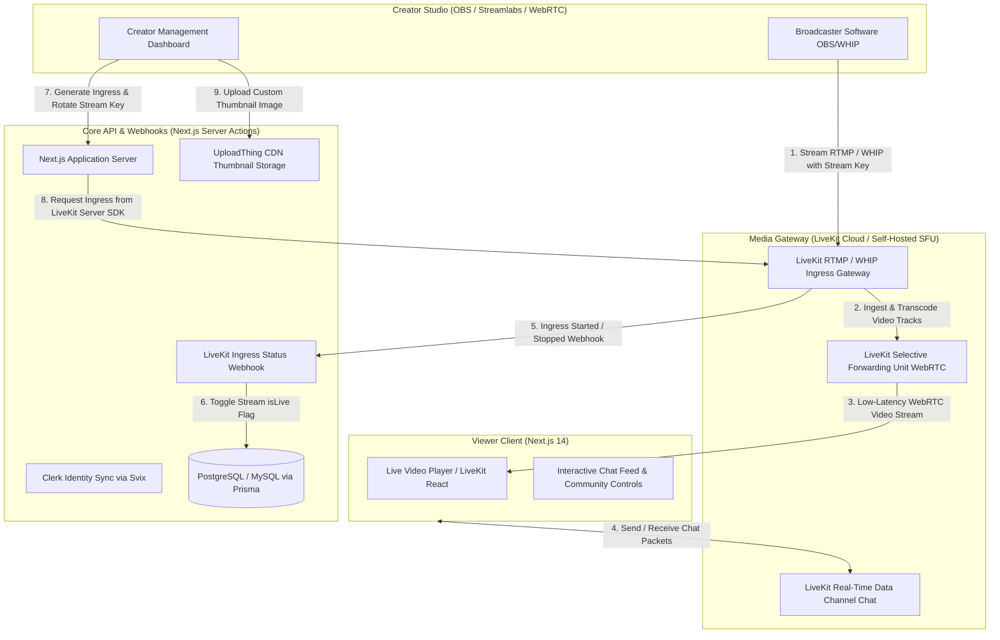

<div align="center">

# GNTI | Broadcast

<p><strong>Next-Generation Live Streaming & Video Platform with WebRTC Ingress, Real-Time Chat & Creator Monetization</strong></p>

<p>A flagship production foundation engineered by <a href="https://gnti.tech">Galaxy Nova Technologies & Innovations (GNTI)</a>.</p>

<p>
  <a href="https://gnti.tech"></a>&nbsp;
  <a href="https://github.com/GNTI-X/broadcast"></a>&nbsp;
  <a href="./LICENSE"></a>&nbsp;
  <a href="https://gnti.tech/projects/broadcast"></a>
</p>

</div>

---

## 📌 1. System Overview

**Broadcast** is an open-source, full-featured live streaming and interactive video sharing platform engineered for high-concurrency broadcasts, gaming streams, and live content creators. Modeled after the architectural resilience of Twitch, Broadcast delivers ultra-low-latency video feeds to thousands of concurrent viewers while maintaining sub-second live chat interactivity.

Built on LiveKit's WebRTC media server mesh, Broadcast allows creators to stream directly from OBS Studio, Streamlabs, or browser-based WHIP endpoints using RTMP or WebRTC ingress. The platform encompasses a rich creator dashboard, stream key management, custom thumbnail hosting with UploadThing, automated follower/subscriber relationship tracking, and granular chat moderation rules (delayed chat, follower-only chat, and viewer bans).

---

## 🏛 2. Architecture & System Flow

### System Architecture Diagram



### End-to-End Workflow

1. **Ingress Allocation & Stream Key Generation**:
   - The creator navigates to the Creator Dashboard and clicks "Generate Ingress".
   - Next.js calls `@livekit/ingress` via the LiveKit Server SDK, generating a unique `serverUrl` (RTMP/WHIP) and `streamKey` stored securely in the database.
2. **Broadcasting & Transcoding**:
   - The creator inputs the credentials into OBS.
   - When the stream goes live, LiveKit's ingress gateway processes the incoming video/audio tracks and forwards them to the LiveKit SFU mesh.
   - LiveKit fires an HTTP webhook to `/api/webhooks/livekit`, updating `isLive: true` in Prisma to surface the channel on the homepage.
3. **Low-Latency Playback & Chat**:
   - Viewers connect to the channel room. Video is streamed with sub-second glass-to-glass latency over WebRTC.
   - Live chat messages are broadcast via LiveKit's real-time data channels.
4. **Community Moderation**:
   - Streamers can toggle chat rules in real time: delay chat by $N$ seconds, restrict chat to followers, or ban/block toxic accounts. All blocks immediately terminate the blocked user's chat permissions.

---

## 🛠 3. Categorized Tech Stack

| Domain | Technology | Purpose |
|:---|:---|:---|
| **Frontend Framework** | `Next.js 14` (App Router) & `React` | Responsive streaming platform with SSR discovery and live client views |
| **Media & WebRTC** | `LiveKit` (`livekit-client`, `@livekit/components-react`) | Sub-second WebRTC video delivery, RTMP ingress, and real-time chat data channels |
| **Server SDK** | `livekit-server-sdk` | Administrative ingress generation, room token minting, and participant moderation |
| **Database & ORM** | `PostgreSQL` / `MySQL` via `Prisma` | Data models for users, streams, follow graphs, and block lists |
| **File Storage** | `UploadThing` | High-speed CDN for stream thumbnails and user avatar uploads |
| **Authentication** | `Clerk` & `Svix` | User account lifecycle management with secure cryptographic webhook synchronization |
| **Styling** | `Tailwind CSS`, `Radix UI` | Dark-mode-first theater layout with collapsible chat sidebars |

---

## 🗄 4. Domain Data Model & Entity Relationships

- **`User`**:
  - `id`: UUID Primary Key
  - `username`: unique string
  - `imageUrl`, `bio`: text fields
  - `externalUserId`: Clerk User ID (unique)
  - `stream`: One-to-One relation with `Stream`
  - `following` / `followedBy`: Self-referencing Many-to-Many relations via `Follow`
  - `blocking` / `blockedBy`: Self-referencing Many-to-Many relations via `Block`
- **`Stream`**:
  - `id`: UUID Primary Key
  - `name`: stream title
  - `thumbnailUrl`: UploadThing CDN URL
  - `ingressId`: unique LiveKit ingress identifier
  - `serverUrl`, `streamKey`: RTMP/WHIP connection parameters
  - `isLive`: boolean flag
  - `isChatEnabled`, `isChatDelayed`, `isChatFollowersOnly`: moderation policy flags
  - `userId`: unique Foreign Key referencing `User`

---

## 🔑 5. Environment Variables Reference

| Variable | Required | Description |
|:---|:---:|:---|
| `DATABASE_URL` | **Yes** | PostgreSQL or MySQL database connection URL |
| `NEXT_PUBLIC_APP_URL` | **Yes** | Web application origin URL (`http://localhost:3000`) |
| `NEXT_PUBLIC_CLERK_PUBLISHABLE_KEY` | **Yes** | Clerk publishable authentication key |
| `CLERK_SECRET_KEY` | **Yes** | Clerk private backend secret |
| `CLERK_WEBHOOK_SECRET` | **Yes** | Svix webhook signing secret for Clerk user synchronization |
| `LIVEKIT_API_URL` | **Yes** | LiveKit cloud or self-hosted HTTP API URL |
| `LIVEKIT_API_KEY` | **Yes** | LiveKit administrative API key |
| `LIVEKIT_API_SECRET` | **Yes** | LiveKit administrative API secret |
| `NEXT_PUBLIC_LIVEKIT_WS_URL` | **Yes** | LiveKit WebSocket URL for client WebRTC connections |
| `UPLOADTHING_SECRET` | **Yes** | UploadThing private API key |
| `UPLOADTHING_APP_ID` | **Yes** | UploadThing application ID |

---

## 🚀 6. Local Development & Deployment

```bash
# 1. Clone repository
git clone https://github.com/GNTI-X/broadcast.git
cd broadcast

# 2. Configure environment
cp .env.example .env

# 3. Install dependencies
npm install

# 4. Push Prisma schema to database
npx prisma db push

# 5. Run development server
npm run dev
```

---

## 🏢 About GNTI

Galaxy Nova Technologies & Innovations (GNTI) builds and deploys scalable software across multi-tenant SaaS, real-time communication, AI automation, and media streaming infrastructure.

- **Website**: [gnti.tech](https://gnti.tech)
- **Official Specification**: [gnti.tech/projects/broadcast](https://gnti.tech/projects/broadcast)
- **Inquiries**: [contact@gnti.tech](mailto:contact@gnti.tech)

---

## 📄 License

Distributed under the **MIT License**. See [LICENSE](./LICENSE) for details.

Copyright &copy; 2026 [Galaxy Nova Technologies & Innovations (GNTI)](https://gnti.tech). All rights reserved.
